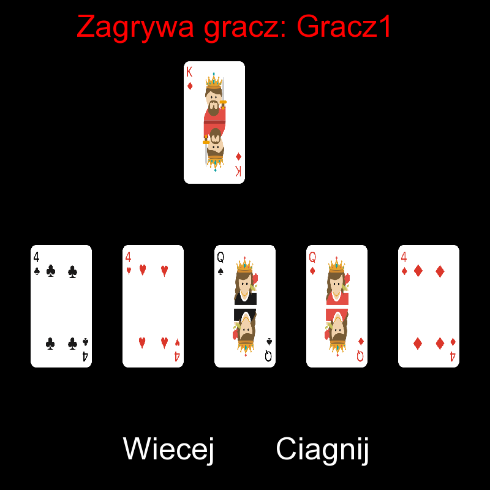

<div align="center">

# 🃏 Makao

Komputerowa wersja klasycznej gry karcianej z interfejsem graficznym, napisana w **C++17** z użyciem biblioteki **SFML**.




</div>

## O projekcie

Gra dla dwóch lub więcej osób, rozgrywana na zmianę przy jednym komputerze (*hot-seat*). Cała rozgrywka odbywa się myszką: gracz klika kartę, którą chce zagrać, a gra pilnuje zasad i obsługuje efekty kart specjalnych.

## Funkcje

- Interfejs graficzny w SFML z klikalnymi kartami i przyciskami
- Sprawdzanie ruchów: niedozwolonej karty nie da się zagrać
- Karty specjalne: dobieranie, stop, żądanie wartości i zmiana koloru
- Osobne ekrany wyboru koloru (as) i żądanej karty (walet)
- Przeglądanie ręki po 5 kart, gdy gracz ma ich więcej
- Gdy talia się skończy, zagrane karty (poza wierzchnią) są tasowane i wracają do talii
- Ekran zwycięzcy

## Zasady gry

Każdy gracz dostaje 5 kart z talii 52 kart, a jedna karta trafia na stół. Na kartę na stole można położyć kartę **w tym samym kolorze lub o tej samej wartości**. Kto nie może (albo nie chce) zagrać, dobiera jedną kartę. Wygrywa ten, kto pierwszy pozbędzie się wszystkich kart.

### Karty specjalne

| Karta | Efekt |
| :---: | --- |
| **2** / **3** | Następny gracz dobiera 2 lub 3 karty i traci kolejkę. |
| **4** | Stop: następny gracz traci kolejkę. |
| **J** | Żądanie: zagrywający wybiera wartość (5–10, Q, K). Dopóki ktoś nie zagra żądanej karty, kolejni gracze muszą ją rzucić albo dobrać kartę. |
| **A** | Zmiana koloru: zagrywający wybiera kolor (♣ ♦ ♥ ♠), który obowiązuje, dopóki ktoś nie zagra karty w tym kolorze. Asa można położyć na dowolną kartę, poza aktywnym żądaniem waleta. |

### Sterowanie

- **Kliknięcie karty** zagrywa ją
- **Więcej** pokazuje kolejne karty z ręki
- **Ciągnij** dobiera kartę i kończy turę

## Uruchomienie

**Wymagania:** Windows, Visual Studio 2022 (z narzędziami C++) oraz [SFML 2.6.2](https://www.sfml-dev.org/download/sfml/2.6.2/) w wersji *Visual C++ 17 (2022) – 64-bit*.

1. Sklonuj repozytorium:
   ```bash
   git clone https://github.com/Robkas116/makao-playing-card-game.git
   ```
2. Pobierz i rozpakuj SFML.
3. Otwórz `Projekt_PK4.sln` i we właściwościach projektu ustaw ścieżki do SFML:
   - *C/C++ → General → Additional Include Directories* → `<SFML>\include`
   - *Linker → General → Additional Library Directories* → `<SFML>\lib`
4. Skopiuj `sfml-graphics-2.dll`, `sfml-window-2.dll` i `sfml-system-2.dll` z `<SFML>\bin` do folderu z plikiem `.exe` (np. `x64\Release`).
5. Wybierz konfigurację **x64** i uruchom grę (`F5`).

> [!NOTE]
> Gra wczytuje grafiki z folderu `Photos/` i czcionkę `arial.ttf` z katalogu roboczego. Przy uruchamianiu z Visual Studio działa to od razu. Jeśli uruchamiasz `.exe` bezpośrednio, skopiuj te pliki obok niego.

Domyślnie grają dwie osoby. Liczbę i nazwy graczy zmienisz w `Main.cpp`:

```cpp
std::vector<std::string> v = { "Gracz1", "Gracz2" };
```

## Struktura projektu

| Plik | Za co odpowiada |
| --- | --- |
| `Main.cpp` | Punkt wejścia: tworzy graczy i uruchamia grę |
| `Gra.h` | Główna pętla gry, efekty kart specjalnych, ekrany wyboru i zwycięstwa |
| `Gracz.h` | Ręka gracza i wybieranie karty myszką |
| `Walidator.h` | Sprawdzanie ruchów i aktywnych żądań |
| `Talia.h` / `Karta.h` | Talia 52 kart, tasowanie i model pojedynczej karty |
| `Button.h` | Klikalny przycisk SFML (z tekstem albo grafiką karty) |
| `Photos/` | Grafiki kart i elementów interfejsu |

## Możliwy rozwój

- Przeciwnik sterowany przez komputer
- Przebijanie kart specjalnych (np. 2 na 2, 4 na 4)
- Wybór liczby i nazw graczy w menu gry
- Budowanie przez CMake, żeby gra działała też na Linuksie i macOS

## Autor

**Robkas116** · [github.com/Robkas116](https://github.com/Robkas116)
